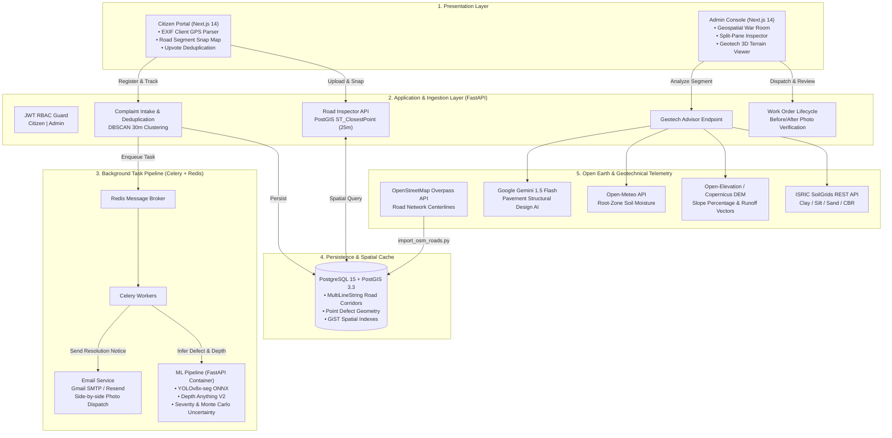

# Architecture & System Design: Kerala Road Damage Decision Support Engine

## System Topology & End-to-End Data Flow

## Security & Access Control
- Passwords hashed with `bcrypt`
- Stateless JWT bearer tokens with configurable expiration (default 24h)
- Dual-role authorization:
  - `citizen`: Can report defects, upvote duplicates, and track tickets
  - `inspector` / `supervisor` / `admin`: Access war-room heatmap, split-pane road inspector, work order completion review, and geotech AI advisory

